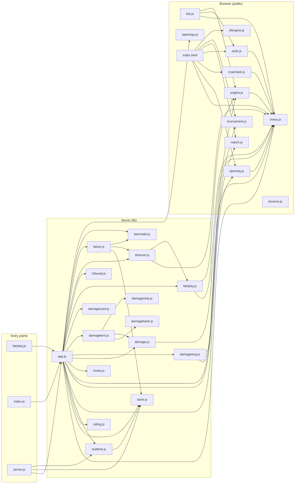

# Code map

Generated by `node scripts/code-map.js`. Arrows mean "requires" (or "loads with a script tag").

## Files

| File | Lines | What it is |
|---|---|---|
| `api/fairplay.js` | 29 | The fair-play check, in its own function so that Stockfish never runs where moves and chat are served. |
| `api/index.js` | 2 |  |
| `server.js` | 38 | Local dev server: node server.js  (on Vercel, api/index.js + public/ are used instead) |
| `lib/app.js` | 2949 | API handler shared by local server.js and the Vercel function (api/index.js). |
| `lib/damage.js` | 351 | The Damage Report: how brutal was this one game? Everything here is deterministic and runs on the server, from a |
| `lib/damagebank.js` | 636 | The fallback bank for The Damage Report: lines used when the AI is down, slow or rejected. Each one is a template |
| `lib/damagecard.js` | 140 | The Damage Report share card: a broadcast-style stat card drawn on the server from a stored card, so it cannot be |
| `lib/damagechat.js` | 50 | In-game chat for the Damage Report. Only messages stored server-side from this game, sent by its two authenticated players, |
| `lib/damageeng.js` | 28 | Engine analysis for The Damage Report: the evaluation of every position of a finished game, as the white side sees |
| `lib/damagetext.js` | 268 | The commentary for The Damage Report. The AI writes the line; nothing it says is trusted: |
| `lib/fairan.js` | 46 | The detector's plumbing: analyse a game with Stockfish (cached, resumable), assess each side with the statistical model |
| `lib/fairmodel.js` | 215 | The fair-play statistical model. Pure functions: rows in (from lib/sfserver.js analyseGame), an assessment out. |
| `lib/fairplay.js` | 68 | Fair play: how engine-like a player's moves are, for admins to review. Nothing here punishes anyone; it only flags. |
| `lib/rating.js` | 91 | Ratings: Glicko-2 (Glickman, "Example of the Glicko-2 system"), one game per rating period like lichess. |
| `lib/realtime.js` | 73 | Push events to browsers so opponents see moves immediately instead of waiting for a poll. |
| `lib/rivalry.js` | 302 | Rivalries: head-to-head records, tiers, streaks, moments and seasons between two players. |
| `lib/sfserver.js` | 173 | Stockfish 19 (lite, single thread, WebAssembly: the same files the browser uses, in public/stockfish/) running on the |
| `lib/store.js` | 137 | Tiny JSON key-value store. Uses Supabase (PostgREST) when SUPABASE_URL + SUPABASE_SERVICE_KEY are set, |
| `lib/tribunal.js` | 74 | Fair-play tribunal: pure rules. When the engine check is sure enough a game is forfeited, a case opens, the community |
| `public/bot.js` | 248 | Chess bot: alpha-beta search over the shared engine (chess.js) for the computer opponents, and the analysis engine |
| `public/chess.js` | 197 | Chess engine shared by server (authoritative) and browser (move hints). |
| `public/coachask.js` | 256 | "Ask the coach": answers questions like "teach me the Caro-Kann" or "what is a pin?" with a short explanation and |
| `public/engine.js` | 533 | Analysis engine: game review, live move grades, the evaluation bar, the coach's grading and the playstyle models. |
| `public/lessons.js` | 303 | Interactive lessons. Every move here is checked by scripts/check-lessons.js (legality + engine). |
| `public/match.js` | 90 | Head-to-head matches: two players play game after game in the same room until the format decides who is better. |
| `public/opening.js` | 61 | Opening recognition shared by browser and server, over the Lichess opening list in openings.js. |
| `public/openings.js` | 4 | Generated by scripts/build-openings.js from the Lichess opening list (CC0). Do not edit by hand. |
| `public/sfengine.js` | 123 | Stockfish as an alternative analysis engine (Stockfish 19 lite, single-threaded WebAssembly, in public/stockfish/; |
| `public/style.js` | 507 | Play against a style: reads how someone plays from their archived games, and plays like them. |
| `public/tournament.js` | 232 | Server-wide tournaments: sign-ups, then group stages and/or a knockout bracket. |
| `public/index.html` | 7248 |  |

## API routes (101, all in lib/app.js, called as POST /api?r=<name>)

- **admin** (29): `admin_access_list`, `admin_access_decide`, `admin_claim`, `admin_overview`, `admin_fair`, `admin_unban`, `admin_mute`, `admin_reset`, `admin_reset_link`, `admin_delete`, `admin_servers`, `admin_dmg_server`, `admin_server_new`, `admin_server_edit`, `admin_move`, `admin_abort`, `admin_clear_chat`, `admin_delete_msg`, `admin_fair_case`, `admin_fair_apply`, `admin_fair_decide`, `admin_fair_inv`, `admin_fair_inv_act`, `admin_fair_flag`, `admin_fair_phrases`, `admin_fair_exempt`, `admin_dmg_targets`, `admin_dmg_target`, `admin_announce`
- **tour** (13): `tour_list`, `tour_get`, `tour_create`, `tour_join`, `tour_vote`, `tour_leave`, `tour_start`, `tour_play`, `tour_remind`, `tour_length`, `tour_award`, `tour_chat_send`, `tour_delete`
- **rivalry** (6): `rivalry`, `rivalry_community`, `rivalry_public`, `rivalry_brief`, `rivalry_archive`, `rivalry_season`
- **fair** (5): `fair_report`, `fair_cases`, `fair_vote`, `fair_comment`, `fair_appeal`
- **game** (3): `game_chat`, `game_chat_send`, `game_get`
- **draw** (3): `draw_offer`, `draw_accept`, `draw_decline`
- **result** (3): `result_send`, `result_answer`, `result_dismiss`
- **pause** (2): `pause_request`, `pause_respond`
- **damage** (2): `damage_feed`, `damage_prefs`
- **clone** (2): `clone_played`, `clone_dismiss`
- **signup** (1): `signup`
- **access** (1): `access_request`
- **login** (1): `login`
- **resume** (1): `resume`
- **recover** (1): `recover`
- **forgot** (1): `forgot`
- **reset** (1): `reset_password`
- **recovery** (1): `recovery_new`
- **me** (1): `me`
- **cam** (1): `cam_signal`
- **rtc** (1): `rtc_signal`
- **profile** (1): `profile`
- **games** (1): `games`
- **style** (1): `style_games`
- **ping** (1): `ping`
- **create** (1): `create`
- **join** (1): `join`
- **room** (1): `room`
- **sync** (1): `sync`
- **move** (1): `move`
- **resign** (1): `resign`
- **unpause** (1): `unpause`
- **rematch** (1): `rematch`
- **rivalries** (1): `rivalries`
- **match** (1): `match_end`
- **presence** (1): `presence`
- **mentions** (1): `mentions`
- **mention** (1): `mention_seen`
- **chat** (1): `chat_send`
- **challenge** (1): `challenge`
- **accept** (1): `accept`
- **decline** (1): `decline`
- **cancel** (1): `cancel`

## Tests (35)

`test-access-ui.js`, `test-access.js`, `test-archive-ui.js`, `test-archive.js`, `test-camera-ui.js`, `test-coach-ask.js`, `test-damage-ui.js`, `test-damage.js`, `test-damagechat.js`, `test-drag.js`, `test-engine.js`, `test-fairdetect.js`, `test-fairmodel.js`, `test-fairplay-ui.js`, `test-fairplay.js`, `test-fairworker.js`, `test-match-ui.js`, `test-match.js`, `test-mentions-ui.js`, `test-mentions.js`, `test-pass-play.js`, `test-premoves.js`, `test-presence-ui.js`, `test-rivalries-ui.js`, `test-rivalries.js`, `test-servers.js`, `test-sfserver.js`, `test-stockfish-ui.js`, `test-style-ui.js`, `test-style.js`, `test-sync-stall.js`, `test-tournament-ui.js`, `test-tournament.js`, `test-tribunal-ui.js`, `test-tribunal.js`
